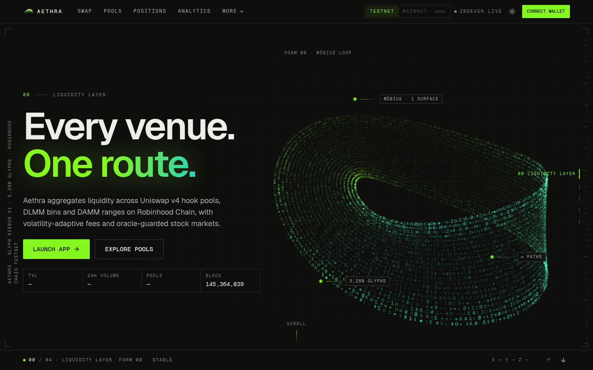
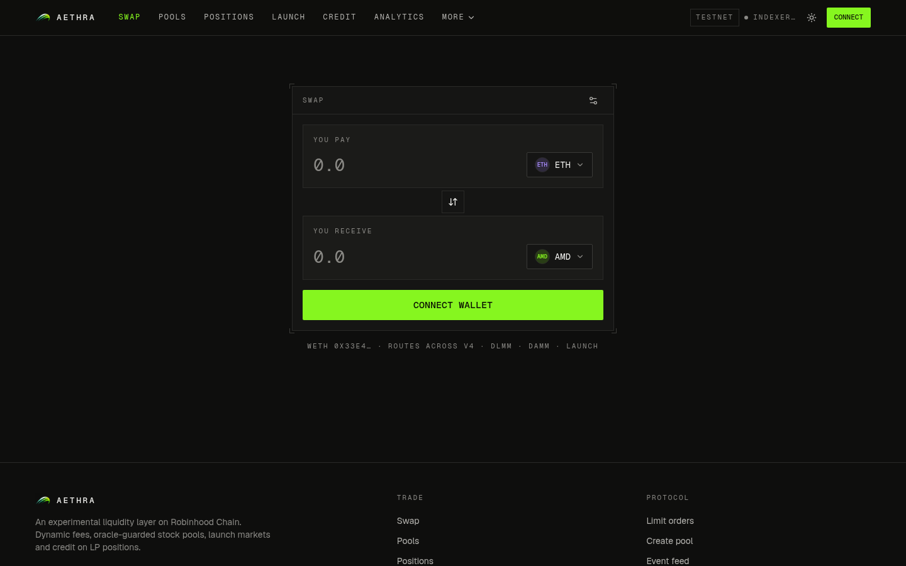
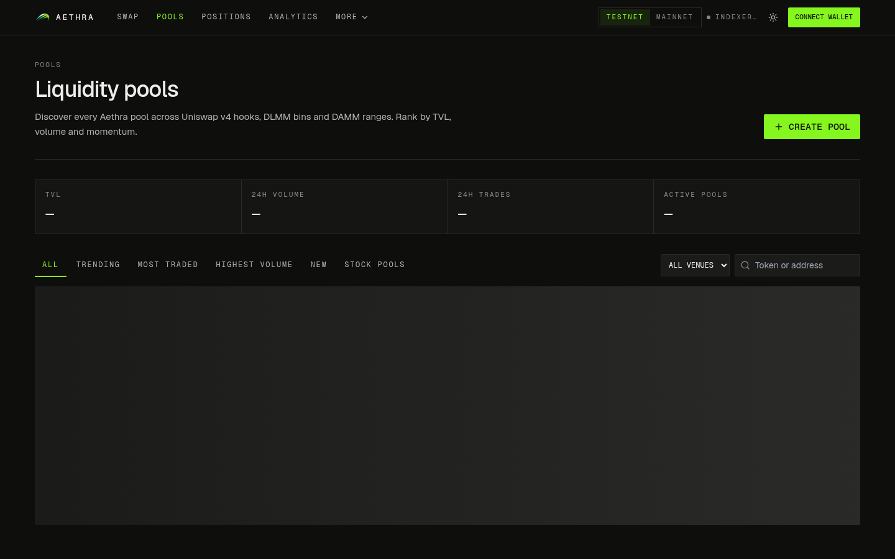
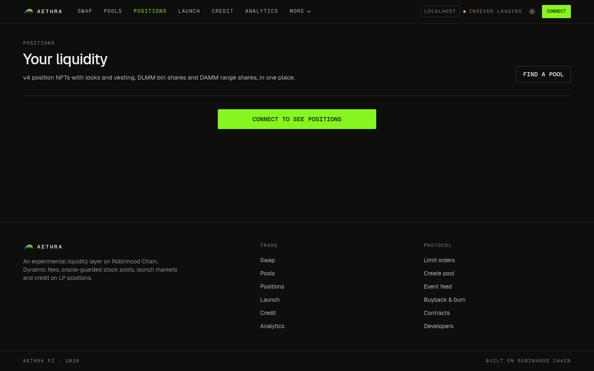

<p align="center">
  
</p>

<h1 align="center">Aethra Fi</h1>

<p align="center">
  A liquidity layer on Robinhood Chain: one smart-routed swap across Uniswap v4, DLMM and DAMM pools,<br />
  with dynamic fees and oracle-guarded markets for tokenized stocks.
</p>

<p align="center">
  <a href="https://aethra.finance">aethra.finance</a> ·
  <a href="https://testnet.aethra.finance">Testnet app</a> ·
  <a href="#quick-start">Quick start</a> ·
  <a href="#architecture">Architecture</a> ·
  <a href="#contracts">Contracts</a>
</p>

<p align="center">
  
</p>

> **Status: experimental.** Contracts are live on Robinhood Chain Testnet. Mainnet contracts are not deployed yet and the contracts have not been audited. Treat everything here as a research project.

## What it does

- **Swap with smart routing.** One router quotes every venue (Uniswap v4, DLMM, DAMM) and the SDK picks the best route. The route search runs in the SDK over `eth_call`.
- **Three pool types.** Concentrated-liquidity v4 pools with an Aethra hook, bin-based DLMM pools, and constant-product DAMM pools. Create a pool from the UI in one flow.
- **Dynamic fees.** The hook raises the fee in volatile moments and drops back to the base fee when the market is calm.
- **Oracle guard for stock pools.** Pools that hold a tokenized stock check an oracle price, widen the fee on deviation and trip a circuit breaker when the pool price drifts too far.
- **Positions.** LP positions are NFTs. Lock them or vest them in the positions locker.
- **Limit orders.** Single-bin orders on DLMM pools.
- **Data.** Pool discovery with filters (trending, most traded, highest volume, fresh), analytics, and a live on-chain event feed.
- **Developers.** A typed SDK and a read-only REST API.

Launchpad markets, credit (LP-backed lending) and buyback & burn are built and tested in the contracts. Their UI is behind a feature flag and not deployed on testnet right now. See [Feature flags](#feature-flags).

## Screens

| Swap | Pools | Positions |
| --- | --- | --- |
|  |  |  |

Dark is the default theme. A light theme ships with the same design tokens. Screenshots for both are in [`docs/ui-style/screens`](docs/ui-style/screens).

## Architecture

```
apps/web                Next.js app (TypeScript, Tailwind, wagmi, viem, RainbowKit, shadcn/ui)
packages/contracts      Foundry project: hub, hook, router, positions, DLMM, DAMM, launchpad, credit, buyback
packages/sdk            ABIs, per-network addresses, route finder, price and bin math
supabase                Postgres migrations, indexer and API Edge Functions, pg_cron schedule
scripts                 Local chain, local and testnet deploy helpers
docs                    Progress, infrastructure, research notes, brand and UI style guide
```

How the pieces connect:

1. Contracts emit events on Robinhood Chain.
2. The `indexer` Edge Function reads them every minute (pg_cron) into Postgres.
3. The `api` Edge Function serves read-only JSON from those tables.
4. The web app reads live state through wagmi and viem, and reads history from the API.
5. The SDK holds the ABIs and addresses that the app, the indexer and integrators all share.

## Contracts

All core contracts are UUPS (ERC-1967) proxies with ERC-7201 namespaced storage. Repeated pool contracts use BeaconProxy so one upgrade covers every pool. SDK, app and indexer always use the **proxy** address.

| Contract | Role |
| --- | --- |
| `AethraHub` | Registry and protocol config: venue registrars, fee config, treasury |
| `AethraHook` | One Uniswap v4 hook for every Aethra v4 pool: dynamic fee, oracle guard, circuit breaker, protocol fee |
| `AethraRouter` | Exact-input swaps across all venues, with WETH wrap and unwrap |
| `AethraPositions` | LP position NFTs with lock and vesting |
| `DLMMFactory`, `DLMMPool`, `DLMMLimitOrders` | Bin-based liquidity and single-bin limit orders |
| `DAMMFactory`, `DAMMPool` | Constant-product pools |
| `AethraLaunchpad`, `LaunchToken` | Launch markets with graduation to a v4 pool |
| `LendingVault`, `CreditManager` | Borrow against LP positions |
| `AethraBuyback`, `AethraToken` (AETH) | Protocol revenue into AETH, then burn |

Aethra reuses the canonical Uniswap v4 `PoolManager` on Robinhood Chain (`0x8366a39CC670B4001A1121B8F6A443A643e40951`) instead of deploying its own. Addresses per network are in [`packages/sdk/src/addresses`](packages/sdk/src/addresses). Every address is also listed on the app's `/contracts` page.

### Build settings

Solidity 0.8.26, EVM `cancun`, `via_ir`, optimizer at 800 runs, `bytecode_hash = none`. The hook is deployed through CREATE2 to an address mined for its permission flags.

## Networks

| | Testnet | Mainnet |
| --- | --- | --- |
| Name | Robinhood Chain Testnet | Robinhood Chain |
| Chain ID | 46630 | 4663 |
| RPC | `https://rpc.testnet.chain.robinhood.com` | `https://rpc.mainnet.chain.robinhood.com` |
| Explorer | [explorer.testnet.chain.robinhood.com](https://explorer.testnet.chain.robinhood.com) | [robinhoodchain.blockscout.com](https://robinhoodchain.blockscout.com) |
| Faucet | [faucet.testnet.chain.robinhood.com](https://faucet.testnet.chain.robinhood.com) | none |
| Aethra contracts | Deployed | Not deployed |

Local development uses an Anvil fork of testnet on chain ID 31337.

## Quick start

Requirements: Node 22.19 or newer, pnpm, [Foundry](https://book.getfoundry.sh/), and Docker if you want the local Supabase stack.

```bash
# Run in: repo root
pnpm install
pnpm dev            # web app on http://localhost:3000
```

Without a deployment on the active network, the app still loads but shows no live data. To run everything locally:

```bash
# Run in: repo root
bash scripts/local-chain.sh           # Anvil fork of testnet (chain 31337)
bash scripts/local-deploy.sh          # deploy all modules by impersonating the deployer
bash scripts/local-activity.sh        # optional: seed real swaps, pools, an order, a loan
supabase start && supabase db reset   # local Postgres with migrations and seed data
pnpm dev
```

The Docker edge runtime cannot reach Anvil on `127.0.0.1`. To index the local chain, run the indexer on the host. See [`docs/infrastructure.md`](docs/infrastructure.md).

### Tests and checks

```bash
# Run in: repo root
pnpm lint
pnpm typecheck
pnpm test                 # vitest (web, sdk)

# Run in: packages/contracts
forge test                # unit and fuzz tests
```

End-to-end browser tests use Playwright (`apps/web/tests`) and cover the main pages in both themes.

## SDK and API

The SDK lives in [`packages/sdk`](packages/sdk). It exports the ABIs, addresses per network, chain definitions, the route finder and price and bin math. It is currently a private workspace package.

```ts
import { getDeployment } from "@aethrafi/sdk";

const testnet = getDeployment("testnet");
testnet.router; // proxy address
```

The read-only REST API is an Edge Function. Responses use the shape `{ data }`.

```
GET {API_URL}/health
GET {API_URL}/chains/{chainId}/pools
GET {API_URL}/chains/{chainId}/pools/{poolId}
GET {API_URL}/chains/{chainId}/dashboard
GET {API_URL}/chains/{chainId}/events
GET {API_URL}/chains/{chainId}/tokens
GET {API_URL}/chains/{chainId}/analytics?range=24h
GET {API_URL}/chains/{chainId}/positions/{owner}
GET {API_URL}/chains/{chainId}/orders/{owner}
```

Launch, buyback and loan endpoints are enabled together with their feature flags.

The app's `/developers` page documents every endpoint with parameters and examples.

## Feature flags

Launchpad, credit and buyback are built but hidden by default. Turn their UI back on with a comma list:

```bash
NEXT_PUBLIC_FEATURES=launchpad,credit,buyback
```

The matching contracts must be deployed on the active network for those pages to work.

## Environments

| Environment | Branch | Frontend | Chain |
| --- | --- | --- | --- |
| Local | `main` | `pnpm dev` | Anvil fork, chain ID 31337 |
| Testnet | `testnet` | `testnet.aethra.finance` | Robinhood Chain Testnet |
| Mainnet | `mainnet` | `aethra.finance` | Robinhood Chain (contracts not deployed) |

Features are built and checked locally on `main`, then promoted to `testnet` with a pull request. Frontend deploys run through the Vercel Git integration. Details for Supabase, Vercel and DNS are in [`docs/infrastructure.md`](docs/infrastructure.md).

## Design

Aethra uses a dark-first design system with a lime primary (`#86F61F`) and a teal secondary taken from the logo. Every color, shadow and glow is a design token defined for both themes as CSS variables, wired into the Tailwind config, with `next-themes` handling the toggle. Fonts are Geist and Geist Mono (SIL OFL). See the [style guide](docs/ui-style/style-guide.md).

## Documentation

- [`docs/PROGRESS.md`](docs/PROGRESS.md): phase status, decisions and the mainnet cost estimate
- [`docs/infrastructure.md`](docs/infrastructure.md): chains, Supabase, Vercel, DNS
- [`docs/ui-style/style-guide.md`](docs/ui-style/style-guide.md): design tokens and visual language
- [`docs/research/notes.md`](docs/research/notes.md): research notes on the existing landscape
- [`packages/contracts/README.md`](packages/contracts/README.md): contracts workspace

## Contributing

Commits follow [Conventional Commits](https://www.conventionalcommits.org/). Git hooks in `.githooks/` run lint, typecheck, tests and `forge test` before every push. Enable them once:

```bash
# Run in: repo root
git config core.hooksPath .githooks
```

Never commit private keys. Deployments use a Foundry keystore (`--account deployer`), and only public addresses live in this repo.

## License

[MIT](LICENSE) © 2026 Aethra Fi
